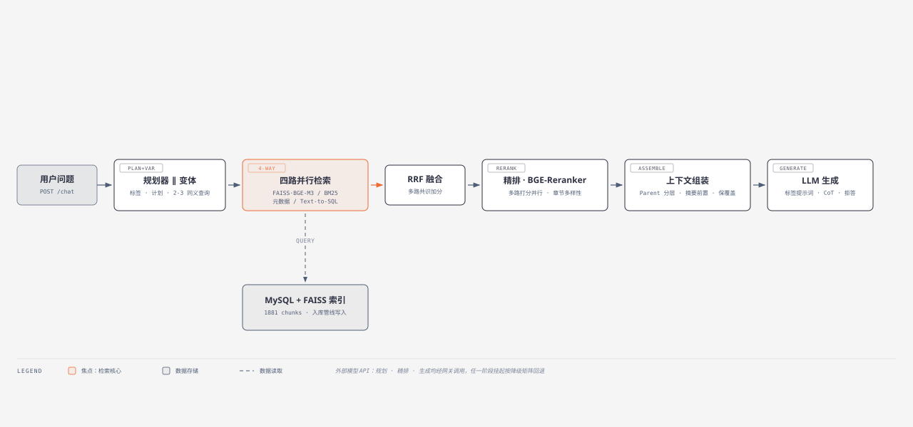
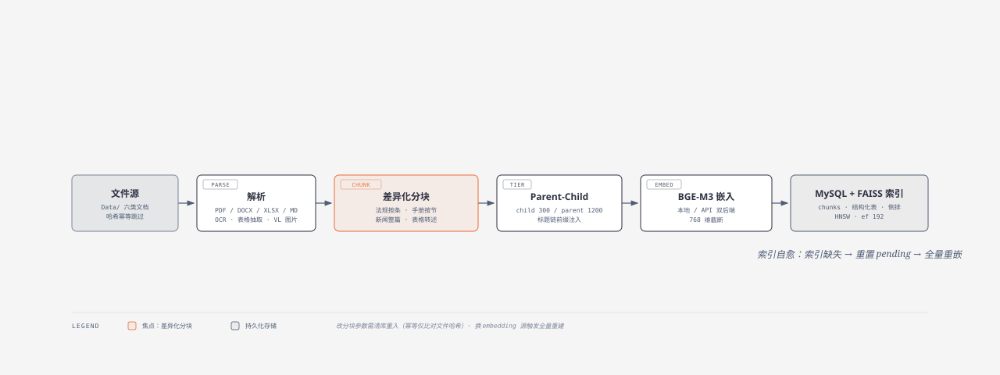
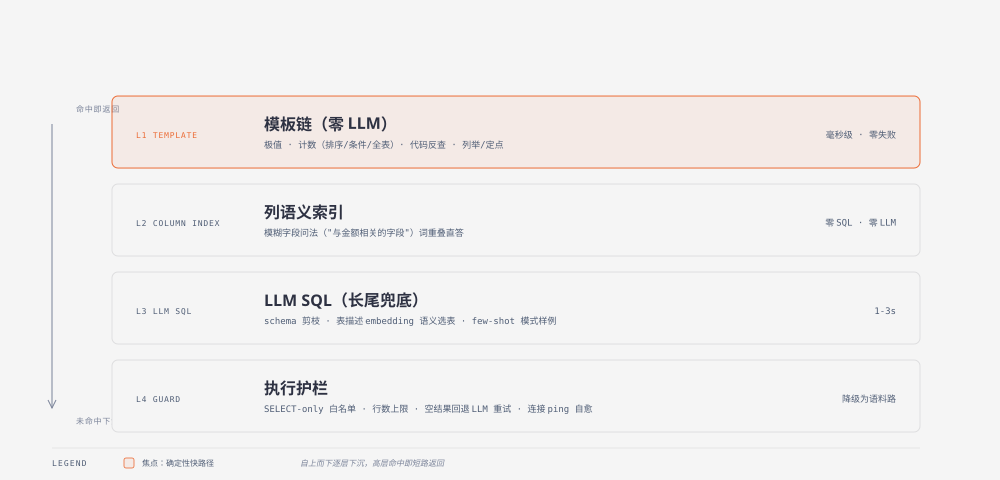

# 架构设计

本文记录 YLSW-RAG 各子系统的设计决策：**做什么、为什么这样做、哪些方案试过被否**。与用户手册（README）和操作手册（运维手册/部署手册）互补——本文只讲设计理据。实验数据均来自本仓库评测集（见 评测说明.md）。

---



> 交互版（含排版细节）：[架构总览图.html](架构总览图.html)

## 1. 总体数据流

```
入库：文件解析 → 文档分类 → 差异化分块 → Parent-Child 分层 → BGE-M3 嵌入 → MySQL + FAISS
查询：实体检测 → 规划器 ∥ 变体生成 → 四路并行检索 → RRF 融合 → 精排
     → Parent 上下文组装 → 标签化提示词生成
```

设计原则贯穿全链：**确定性优先（能用规则不用 LLM）、多点并行（LLM 调用与检索路并发）、全链降级（单点故障不阻断作答）、30s 预算是硬约束**。

---



> 交互版：[入库管线图.html](入库管线图.html)

## 2. 入库管线

### 2.1 差异化分块（而非统一切分）

金融语料结构差异极大：法规按条款、手册按操作步骤、新闻是完整叙事、表格是结构化行。统一 512 token 切分会把条款截断、把 FAQ 问答拆散、把表格行切开。

| 文档类型 | 分块策略 |
|---|---|
| 法规（REG） | 按"第X条"边界切，条款完整不跨块 |
| 手册（MAN/PDT） | 按章节标题树切（H2/H3），标题链前缀注入块首 |
| 新闻/报告（NWS/RPT） | 整篇或按自然段，保留叙事完整性 |
| 表格（TBL） | xlsx 转 markdown 转述 + 结构化行入库（供 SQL 路），小表（≤5 行）保留在语料 |

**标题链前缀**：每个 chunk 文本首部拼接 `# 文档标题 > ## 二级标题 > ### 三级标题`。这既是检索时的弱语义信号，也让 LLM 在上下文中知道该片段的出处层级——正是精排"章节多样性"选择所需的 H2/H3 结构来源。

### 2.2 Parent-Child 分层（300 / 1200 token）

检索用小 child 块（300 token，语义聚焦、向量质量高），生成用大 parent 块（1200 token，上下文完整、答案素材全）。二者通过位置区间映射，组装时 top1 取 parent、其余取 child，兼顾召回精度与 token 预算。

**分块参数变更必须清库重入**（ingest 幂等只比对文件哈希）——这是运维手册 §3 第一条红线的由来。

### 2.3 索引自愈

FAISS 索引不随库提交（.gitignore / .dockerignore 排除），容器启动时检测：索引缺失且库里有 embedded chunk → 全部重置 pending → 按当前 embedding 源全量重嵌 → 重建索引。**这保证"换 embedding 源"（模型/平台切换）后不会出现向量与库错位**——错位时检索语义路全废，且症状隐蔽（表现为"答非所问"而非报错），运维手册 §5 有专门事故记录。

---

## 3. 四路检索与 RRF 融合

### 3.1 为什么是四路

单路各有盲区，四路互补：

| 路 | 覆盖的能力 | 盲区 |
|---|---|---|
| FAISS 语义（BGE-M3） | 同义改写、模糊描述（"怎么开通"≈"接入流程"） | 精确编号/文号（字面符号无语义信号） |
| BM25 词法 | 精确文号、产品名、编号 | 同义改写、长句语义 |
| 元数据精确匹配 | 产品/机构/类型结构性过滤 | 无实体的问题 |
| Text-to-SQL | 结构化表格的聚合/计数/取值 | 非表格类问题 |

**文号 token 保护**（BM25 路的关键增强）：jieba 会把"银发〔2018〕190号"切成 6 个碎片，且括号形/无括号形/带年形三种写法互不匹配。分词前用正则把文号/版本号/型号归一为纯 ASCII 单 token（`银发〔2018〕190号` → `wenhao2018190`），索引侧与查询侧共用同一函数——纯文号查询从"失配"变为"精确命中"（实测：`V4.2.7`、`银监办发2008263号` 等四类查询全命中正确文档）。**零 API 成本、零维护负担**（对比"时间实体解析"方案：文档内多时间点、题目时间可能指条款而非整篇，生产级维护成本高，已放弃）。

**动态实体枚举**：机构/产品枚举不再纯硬编码——启动时从 `chunks.org_name` / `product_name` + `product_mentions` 倒排表同步到内存，硬编码仅作兜底。新语料入库后实体检测自动覆盖（实测同步出"一川""锦缎"等 7 个硬编码外机构）。新增产品自动触发倒排重建。

### 3.2 为什么用 RRF 而非加权分数

四路分数量纲不可比（余弦相似度 ~0-1、BM25 ~0-40、元数据固定 boost、SQL 无分数），任何加权都需要跨路归一化，而归一化本身引入超参数且随语料漂移。RRF（`Σ 1/(k + rank)`）只用**排名**，天然免疫量纲问题；同一 chunk 多路命中时分数相加——"多路共识"自动获得更高排名，这正是混合检索的价值所在。

### 3.3 HNSW 参数用数据定

`ef_search=192`：30 真实问题实测，ef=40 时 recall@50 仅 93.3%（丢 6.7% 邻居），ef=192 达 100%，延迟增量仅 +0.2ms/次（微秒级基线）。**取满分拐点而非经验值**。

---

## 4. 规划器（LLM Plan-and-Solve）

### 4.1 一次调用出三样东西

规划器单次 LLM 调用同时输出：**问题标签**（六类，决定生成提示词）、**执行计划**（single / parallel_subq / multi_hop DAG）、**异常判定**（reject + reason）。分三次调用会多两跳网关往返（各 ~1.5s），30s 预算下不可接受。

计划类型由题目结构决定：单一查询走 single；多实体并列问题（"A 和 B 的费率"）走 parallel_subq 并行检索；有依赖链的问题（"先查公司名单，再逐公司查邮箱"）走 multi_hop + foreach 逐实体展开。DAG 的 ready 步骤用线程池并行执行。

### 4.2 拒答判定的设计取舍（与常见做法不同）

常见 RAG 用规则或分类器拦截"闲聊/注入"，本项目**拒答只由 LLM 的注入判定触发**（reason=injection）；reason=chitchat 不放行拒答、走正常管线。原因来自实测事故：ChatGPT 支付题被规划器误判 chitchat 直接拒答（正常业务题得零分）。放行后该类题走完整检索正常作答；真正闲聊因检索为空由生成层兜底文案。

安全考量：**没有任何代码层"关键词豁免"路径**（曾考虑域关键词跳过 LLM 判定，被否——攻击者可构造"支付<注入>"混合问题绕过）。拒答的唯一触发源是 LLM 对注入意图的判定，代码不参与安全决策。

### 4.3 变体生成与规划并行

变体（2-3 条同义查询）原设计在规划器之后串行生成（依赖改写结果）。实测规划器对绝大多数单步题都会改写查询（运维手册 §5 #17 记录改写率接近 100%），变体与改写结果高度同质——改为**只基于原问题生成**后可与规划器并行发出，总耗时从两跳 3.5s 降至 max ~2s。检索侧把 [改写查询 + 变体] 合并成一次批量 embedding API 调用，再并发 `search_vec`。

**被否方案**：变体并入规划器单次调用（省一跳）——收益与并行相同但 planner JSON 结构复杂化、解析失败面增大，并行方案更稳。

---

## 5. 精排与上下文组装

### 5.1 章节多样性选择（而不是纯分数排序）

纯按 rerank 分数取 top-k 在概述类问题（"2024 年经济热词有哪些"）上必然失败：单个高相似章节的多个碎片占满名额，其余章节整章缺料。三轮贪心：① 每 (文档,H2,H3) 章节取最高分 1 条（分数门槛 = 最高分 85%）；② 未覆盖章节补位（门槛 0.5）；③ 剩余名额按分数补位并做邻域去重。声明/来源类工具章节直接排除（`_JUNK_H2S`）。

### 5.2 多路打分并行

多步题的精排要对 [原问题 + 各子问] 打分取 max（原问题对第二问有语义稀释）。N+1 次 rerank API 调用**互相独立**（同一批文档、不同 query 串），多跳依赖只影响检索阶段、精排时候选池已固定——全部并行发出。多文档题精排从 2.2s+ 降至 1.4-1.8s。本地 reranker 后端保守串行（CPU 模型并发推理无保障）。

### 5.3 邻域补全与版本去重

- **邻域补全（±8）+ 融合池兄弟扩展（±3）**：法规条款类问题，正确细节块常与已选块位置相邻但精排分数低被裁——补入同文档相邻候选，治"条款细节丢失"。
- **版本去重**：同文档多版本（V1.0/V2.8、多年文号）同时召回时只留最新版，避免旧版内容混入答案。
- **Parent 1500 字截断**：实测 top1 parent 达 2776 字符是最大单项脂肪，截 1500 保留章节主体。

### 5.4 文档摘要前置（多步题专属）

综述类问题的痛点：LLM 从零散 chunk 归纳时漏要点。方案：`ingest/summarizer.py` 用严格提示词（逐章节覆盖、不得添加原文没有的内容、400 字上限、超长强化重试）为每文档生成要点摘要存 `documents.doc_summary`；查询时对**多步题**把最终进上下文的文档摘要（≤3 篇 × 350 字）前置到上下文头部——利用 LLM 首因效应建立文档全局结构。**摘要不参与检索/embedding**（无需清库重入），单步题不追加（parent 已覆盖全貌，避免挤占预算）。

### 5.5 上下文截断策略（保覆盖而非保深度）

原实现"从前往后塞、超预算丢尾部"——多文档对比题的尾部正是某银行的唯一条目，整条丢弃导致"漏维度"。改为：**前 3 条全量（rerank 榜首含答案，保深度），其余按剩余预算均分截断（下限 300 字，保覆盖）**。所有来源保持代表性。

**被否方案**：文档级配额（每文档上限 3 条）——实测改善文档分布但答案质量零提升（LLM 波动范围内），已回滚；单步题跳过精排——实测丢精度（运维手册 §5 #16）。

---



> 交互版：[SQL四层链图.html](SQL四层链图.html)

## 6. SQL 路：模板链 + LLM 双层架构

### 6.1 为什么不是纯 LLM SQL

纯 LLM 生成慢（1-3s/次）、对高频模式（计数/列举/字段查询）不稳定。**确定性模板处理高频模式**（毫秒级、零失败率），LLM 兜底长尾。模板按**查询模式**编写（计数/极值/列举/反查），不按表编写——**新表入库零代码适配**，这是防"模板随表膨胀"的核心原则。

模板链：极值（ORDER BY CAST LIMIT 1）→ 计数（排序/条件/全表三层，触发词收紧防误拦聚合题）→ 代码反查（代码值取实体）→ 列举/定点查询（列值 DISTINCT / 实体定点）。条件计数自动识别公司/收费部/路段实体（表内取值精确匹配），支持双条件组合。

### 6.2 SQL 路的三个普适增强

1. **schema linking 向量化**：关键词触发词未命中时，用表描述 embedding（表名+列名+样例值，启动构建）语义选表 top-2。随表数线性扩展，新表自动进索引。
2. **列语义索引**：schema_registry + 字段字典 COMMENTS 建 jieba 词索引，模糊字段问法（"与金额相关的字段"）词重叠直答——不生成 SQL、不调 LLM。
3. **执行护栏**：SELECT-only 白名单（`sqlparse` + 表名白名单 + 危险模式正则三重校验）、行数上限 100、**空结果自动回退 LLM 重试**（模板实体识别错时自救）、**连接 ping 自愈**（服务端闲置超时关闭连接后自动重建，此前会导致首个 SQL 查询崩溃整个请求）。

### 6.3 实测出的三个隐蔽 bug（已修）

- DISTINCT 列值列举被行数上限截断 → "多少个"类问法改 `COUNT(DISTINCT)` 直答（代投点 107 曾被答成 50）
- `CAST AS DECIMAL` 结果含 Decimal 对象使 JSON 序列化失败 → 静默回退语料（而语料无表格数据）→ `json.dumps(default=str)`
- hint 拼接全列字段清单诱导 LLM 误读结果语义（"路段列表"被当成"代投点取值"）→ 模板路径 hint 改条件注记（"已按 X 过滤"）+ 语义声明

---

## 7. 生成层规则体系

### 7.1 标签动态提示词

规划器六类标签各配 JSON 提示词文件（风格/格式/字数/专项规则），生成时按标签拼接。比单一 mega-prompt 更可控：数据查询标签要求"结论数字在前、列点不展开"，政策法规标签要求"逐条引用文号"——风格冲突的规则分文件隔离。

### 7.2 三条核心生成规则（均由评测失败驱动）

| 规则 | 治的问题 | 实测效果 |
|---|---|---|
| **要点拆解自查**：多要点问题先拆清单逐条作答，每要点给资料内容或明确标注缺失，禁止笼统"资料未包含" | 细节在上下文但输出遗漏（金库三频率、收费清单、逐级授权、新牌照名单） | 错误 8→2 |
| **时间线 CoT**：多文号/日期问题强制三步推理（逐文列规则与生效时间 → 按业务时点判适用 → 结论），结论必须与判定一致 | 跨法规时间线推理（207/190 过渡期、准备金率调整） | 时间线题从错误降至部分正确 |
| **数值误差声明**：求和/求差列完整算式、保留两位小数、注明 ±0.01 舍入误差 | LLM 心算误差与编造 | 数值题不再虚报精确值 |

另含 FAQ 结构规则（"什么是 X"条目常含配置方法，禁止按标题字面判"未包含"）与语言适配（中英提问/文档交叉时必须用提问语言作答）。

### 7.3 thinking 模式的取舍

DeepSeek 官方 API 支持 thinking，但实测 800 token 输出预算被 reasoning 全部吃光（正文为空）；提到 2000+ 则耗时逼近 20s 生成预算。结论：**用 prompt 强制 CoT 替代 API thinking**——效果等价（官方模型关闭 thinking 时本身在输出中分步推理），耗时可控。

---

## 8. 30s 硬约束与降级矩阵

| 阶段 | 超时 | 降级行为 |
|---|---|---|
| 规划器 | 5s 短试 + 5s 救援 | 全失败回退单步管线（不拒答） |
| 变体生成 | 5s 单次 | 静默回退单查询 |
| 检索（本地 + embedding API） | API 超时 90s | 单路失败其余照常（BM25 路启动失败仅关闭该路） |
| 精排 | 5s retries=1 | 挂起回退 RRF 排序 |
| LLM 生成 | 20s retries=1 | 该题失败回错误文案 |
| SQL 路 | 内部异常 | 全部降级 None（纯语料路继续） |
| 空融合池 | — | 跳过精排/生成直接回未找到 |

最坏路径（规划+精排双双挂起）约 17s；实测 140 题最坏 11.9s，超 30s 零题。

**keepalive 线程**每 8 分钟 ping 网关端点防冷池（冷启动 40-60s 在 30s 预算下必败）。**HTTP 客户端每请求独立连接**（`Connection: close`）——曾因连接池复用半死连接导致规划器挂起 92s，可靠性优先于复用收益。

---

## 9. 评测驱动的优化闭环

所有重大改动都走同一流程：**trace 采集定位机制 → 定向修改 → 全量回归（140 题 + judge）→ 数据说话（留/回滚）**。本仓库中被数据否决并回滚的方案：文档级配额、单步跳精排、投机预取、sparse 融合、时间实体解析。保留但默认关闭的实验开关：`RERANK_SKIP_SINGLE`（供后续 A/B）。
